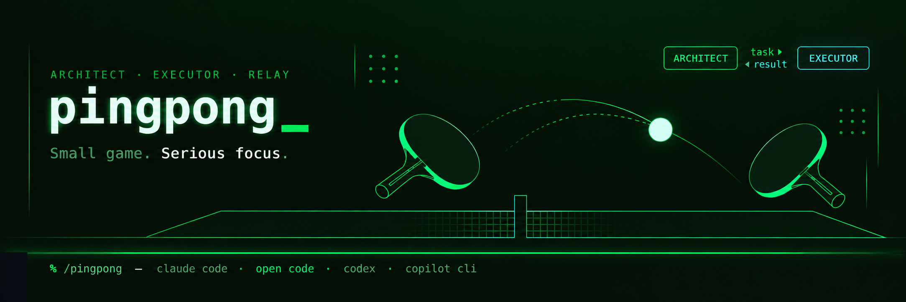

# pingpong

**Two sessions, one loop — you hold the pen.**

**pingpong** packages the **Architect/Executor** two-session AI development pattern as a set of slash-command skills. It is the **optional companion** to the generic [orfi-kit](#prerequisite--orfi-kit). The pattern was originally explored as a standalone desktop app codenamed *SonOfAnton* — that app was **shelved**. pingpong is **skills-only: there is no app**, no daemon, no background process. Everything is commands you invoke inside your AI CLI.

## Prerequisite — orfi-kit

**Install [orfi-kit](https://github.com/) first.** pingpong is a separate add-on, **not merged** with orfi-kit. The dependency is soft — the AE commands are nearly standalone — but the Architect/Executor workflow leans on orfi-kit's generic git / test / guardrail skills to get work done. The installer only **warns** if orfi-kit is missing (it never blocks); this README is where the requirement is documented.

## The Architect/Executor pattern

You run **two context-isolated AI sessions** against one piece of work:

- The **Executor** session orchestrates — it spawns agents to do the implementation work, verifies their output, and reports results back. It does not implement code directly unless the user explicitly authorizes it.
- The **Architect** session directs and verifies — it decides what to build next, writes the task brief, and critically reviews what the Executor reports back. The Architect also acts as an **interactive thinking-partner / sidekick** to the human: helping draft the prompts that go to the Executor and helping decode the Executor's questions and results.

The two sessions never share a context window. They communicate **only through file-based relay files** on disk. A **human sits at the decision points** — approving tasks, resolving blockers, and steering the loop.

## Why two sessions, not one session with a sub-agent?

A single AI session can spawn sub-agents, but that is not the same as two truly separate sessions. The distinction matters:

- **Context isolation** — each session has its own context window. Architect and Executor work independently; neither accumulates the other's file reads, test output, or diff noise. A single session doing both roles burns context rapidly and degrades quality as the window fills.
- **Independent verification** — the Architect's job is to critically review what the Executor produces. If both roles run in the same context window the "review" is just the model reading its own prior output. Separate sessions produce a genuinely independent second read.
- **Concurrent execution** — the Executor can be running tests or building while the Architect is reviewing a previous result, updating state files, or drafting the next task. Sub-agents launched from one session block or compete; separate terminals run in parallel.
- **Explicit, auditable handoff** — relay files on disk are the only channel. Every task brief and every result is a written artefact the human can read, approve, or redirect before the loop continues. Sub-agent calls are invisible to the human unless they happen to watch the transcript.
- **Human stays in the loop** — because the human physically switches terminals and sends the relay, every cycle has a natural checkpoint. Nothing proceeds without a conscious act. A sub-agent loop can run to completion without the human ever seeing an intermediate result.
- **Model flexibility** — each session can run a different model tier. The Architect can use a reasoning-heavy model for design decisions while the Executor uses a faster model for implementation. Sub-agents launched from one session are constrained by whatever that session supports.

## The relay loop

```
set-helper-files-root (one-time per repo — configure the helper-files root)
  → orient (Architect / Executor each orient their own session)
    → relay-to-executor (Architect writes task)
      → relay-read-task (Executor reads task)
        → Executor orchestrates the work
          → relay-to-architect (Executor writes result)
            → relay-read-result (Architect reviews critically)
              → repeat (Architect relays the next task)
```

## Command reference

| Command | Role |
| --- | --- |
| `/pingpong-set-helper-files-root` | Setup: configure (create or change) the per-repo helper-files root. |
| `/pingpong-init` | Setup: bootstrap the kit files (orientation + onboarding + session-state placeholders) under the root — create-if-absent, never overwrites. |
| `/pingpong-orient-architect` | Orient this session as the Architect (reads orientation + session-state + onboarding). |
| `/pingpong-orient-executor` | Orient this session as the Executor (reads executor-orientation + session-state + onboarding). |
| `/pingpong-relay-to-executor` | Architect: write the next task to the executor relay file. |
| `/pingpong-relay-read-task` | Executor: read the task the Architect left. |
| `/pingpong-relay-to-architect` | Executor: write your result/report back. |
| `/pingpong-relay-read-result` | Architect: read and critically review the Executor's result. |
| `/pingpong-model-routing` | Both roles: read or update the model-routing config (report high/low tiers, or set them with `high <model>` / `low <model>`). |
| `/pingpong-auto` | Architect: autonomous relay loop via Herdr — relay, nudge, wait, read, repeat until DONE. *(Installed only with Herdr support.)* |
| `/pingpong-auto-stop` | Any pane: stop a running ping-pong loop at its next checkpoint. *(Installed only with Herdr support.)* |

In Claude Code these are **commands**; in GitHub Copilot CLI and OpenAI Codex CLI the equivalent **skills** serve the same role (in Copilot a skill is its own slash command; in Codex a skill is selected via `/skills` or mentioned with `$`). Full parity: every Claude command is mirrored as a Copilot skill and a Codex skill — 9 core, plus 2 optional ping-pong commands installed only with Herdr support.

## Getting started

1. **Install** the kit for your runtime(s) — see [Install](#install) below.
2. **Open two terminals**, each running its own AI CLI session in the same repo — one will be the Architect, one the Executor. (Different models/CLIs are fine; that's a feature.)
3. **One-time per repo:** in either session, run `/pingpong-set-helper-files-root` (point it at your helper-files directory), then `/pingpong-init` to bootstrap the orientation, onboarding, and session-state files.
4. **Orient the sessions:** run `/pingpong-orient-architect` in one terminal and `/pingpong-orient-executor` in the other.
5. **Run the loop:**
   - In the Architect: `/pingpong-relay-to-executor` — describe the task; it writes the relay file.
   - Switch to the Executor: `/pingpong-relay-read-task` — it reads the task, orchestrates agents to do the work, verifies the results, then `/pingpong-relay-to-architect` to write its report.
   - Back in the Architect: `/pingpong-relay-read-result` — it critically reviews the result and drafts the next task.
   - Repeat. You are the relay — every hop passes through your hands.

### Optional: Herdr and ping-pong mode


*The kit at work inside Herdr: Executor (left) and Architect (right) oriented in side-by-side panes.*

If you opted into **Herdr support** at install time and both sessions run inside [Herdr](https://herdr.dev) panes labeled `architect` and `executor`, two extras become available. (You don't have to label the panes yourself — the orient commands self-label: each session detects it's inside Herdr and renames its own pane to its role.) (Herdr is an agent terminal multiplexer — see the [herdr repo](https://github.com/ogulcancelik/herdr) and its [agent skill](https://herdr.dev/docs/agent-skill/), which the installer sets up via `npx skills add ogulcancelik/herdr --skill herdr -g`.)

- **Nudging (no new command needed):** instead of switching terminals yourself, tell the Architect in plain language — *"relay this and nudge the executor"* — and it delivers the read command into the Executor's pane via Herdr. Still one hop; control returns to you.
- **`/pingpong-auto`:** run in the Architect's pane to let the two sessions iterate autonomously — relay → nudge → wait → review → repeat — until the Executor reports `## Status: DONE`, an agent needs user input, a pane becomes unavailable, or you stop it. Wait timeouts are status-check intervals, not task deadlines: the Architect keeps waiting idly while the Executor is working. The relay files remain the only data channel, so every hop stays on disk and auditable.
- **`/pingpong-auto-stop`:** run from **any** pane to halt the loop at its next checkpoint (it drops a STOP sentinel the Architect checks before every hop). For an immediate abort, press Esc/Ctrl+C in the Architect's pane.

Without Herdr, none of this exists — the kit works exactly as described above, with you carrying every hop.

## Install

Two equivalent installers — use whichever matches your shell.

```bash
# bash (Linux / macOS / WSL)
./install.sh
```

```powershell
# PowerShell (Windows PowerShell 5+, or pwsh anywhere)
./install.ps1
```

Each launches an interactive runtime menu:

```
Install for which runtime(s)?
  1) Claude Code
  2) OpenCode
  3) GitHub Copilot CLI
  4) OpenAI Codex CLI
Select one or more (e.g. '1', '3', or '1 2 3 4' / '1,2' for several).
```

Selections may be **space- or comma-separated** (`1`, `1 2`, `1,3`, `1 2 3 4`).

The installer then asks whether you want **Herdr support** (autonomous
architect↔executor ping-pong). Answering yes installs/updates
[Herdr](https://herdr.dev), installs its agent skill
(`npx skills add ogulcancelik/herdr --skill herdr -g`), and includes the two
ping-pong commands. Answering no installs the kit exactly as before — manual
relay mode only. Uninstall always removes the ping-pong commands if present,
but never touches Herdr itself.

### Flags

| bash | PowerShell | Meaning |
| --- | --- | --- |
| `--link` | `-Link` | symlink instead of copy (dev mode: repo edits go live) |
| `--uninstall` | `-Uninstall` | remove an existing pingpong install |
| `--help` / `-h` | `-Help` | print usage |

### Install destinations

| Runtime | Source | Destination |
| --- | --- | --- |
| Claude Code | `claude/commands/*.md` | `~/.claude/commands/` |
| OpenCode | `claude/commands/*.md` | `~/.config/opencode/commands/` (honours `$XDG_CONFIG_HOME`) |
| GitHub Copilot CLI | `copilot/skills/<dir>/` | `~/.copilot/skills/` |
| OpenAI Codex CLI | `codex/skills/<dir>/` | `$CODEX_HOME/skills/` (default `~/.codex/skills/`) |

Claude and OpenCode share the same **command** source; each gets its own copy in its own commands dir. Copilot's **skills** come from a different source dir and install to their own home; Codex likewise has its **own** adapted skill copy (`codex/skills/`) installing to its own home (`$CODEX_HOME/skills/`, default `~/.codex/skills/`) — skill selected via `/skills` or mentioned with `$`, no command file.

## Uninstall

```bash
./install.sh --uninstall
```

```powershell
./install.ps1 -Uninstall
```

Removes the commands from the Claude/OpenCode commands dirs and the skill dirs from `~/.copilot/skills` and `$CODEX_HOME/skills` (default `~/.codex/skills/`), for whichever runtimes you select — including the two ping-pong commands if present (Herdr itself is never touched).

## The helper-files root (per-repo, configurable)

The relay, orientation, onboarding, and session-state files all live under a single **helper-files root** directory. The commands no longer hard-code a path — instead each resolves the root from a small **per-repo pointer file**, so every repo keeps its own separate state and they never overwrite each other.

**Configure it once per repo** — run `/pingpong-set-helper-files-root` (pass the path, or it will prompt you). That writes:

```
.orfi-kits/helper-files-root   one line: the absolute path to your helper-files root
```

`.orfi-kits/` is **tracked** (committed) on working branches, so the pointer propagates worktree → epic → child worktrees via the branch checkout. It is stripped from the final tree before the epic's PR merge by `/orfi-kit-cleanup-state`. Any command that needs the root reads the pointer first; if it isn't set yet, the command configures it on the spot, then continues. There is **no fallback** to any previous default path.

**Then bootstrap the kit files** — run `/pingpong-init` once per repo. It creates the orientation, onboarding, and session-state files under the root **only if they don't already exist** (it never overwrites; if the repo is already initialized it says so and quits). The orientation files it writes are **generic/agnostic** — all project-specific rules (stack, conventions, ADR location, test commands, security gate, terminology) live in `ONBOARDING.md`, which the orientation files redirect agents to read.

The helper-files root is a general bucket, so the kit keeps its files in a dedicated **`orfi-kits/` subfolder** under the root (the pointer stores the root; the commands append `orfi-kits/`):

```
<root>\orfi-kits\relay\relay-to-executor.md     (task: Architect → Executor)
<root>\orfi-kits\relay\relay-to-architect.md    (result: Executor → Architect)
<root>\orfi-kits\architect-orientation.md       (generic: who the Architect is / how it operates)
<root>\orfi-kits\executor-orientation.md        (generic: who the Executor is / how it operates)
<root>\orfi-kits\MODEL-ROUTING.md               (model routing config — high/low tiers per runtime)
<root>\orfi-kits\CLAUDE-SESSION-STATE.md        (shared handoff state — Claude)
<root>\orfi-kits\COPILOT-SESSION-STATE.md       (shared handoff state — Copilot)
<root>\orfi-kits\CODEX-SESSION-STATE.md         (shared handoff state — Codex)
<root>\orfi-kits\ONBOARDING.md                  (project single source of truth, read if it exists)
```

The same pointer is shared with **orfi-kit** (which reads `CLAUDE-SESSION-STATE.md` from it via its own `/orfi-kit-set-helper-files-root` command), so the Architect/Executor handoff and orfi-kit's state commands all agree on one root per repo.

## Model routing

The kit routes work by model tier: **high-model thinking work** and **low-model execution work**. The routing config lives in `<root>\orfi-kits\MODEL-ROUTING.md`, created by `/pingpong-init` (with placeholders) or by `/pingpong-model-routing` if missing. It has four sections — **Claude Code**, **OpenCode**, **Copilot CLI**, **Codex CLI** — each holding a `high_model` (the thinking tier, e.g. Opus) and a `low_model` (the execution tier, e.g. Sonnet).

Run `/pingpong-model-routing` after orienting a session. With no arguments it reports this runtime's high/low models and installs the routing rules:

- **High model — the session itself runs on it:** design, ADR/PRD review, planning, orchestration (both roles), reading relay/tasks/designs, verification, driving the Executor (pingpong), and branch/master sync + merge-conflict resolution.
- **Low model — delegate to spawned agents:** execution/implementation, git operations (except sync and merge conflicts), Jira/Atlassian operations, persisting state/onboarding files, and any mechanical work.

Update the config with `high <model>` / `low <model>` (or just tell the session in a prompt), or edit the file manually. For example:

```
/pingpong-model-routing            # report the current high/low models for this runtime
/pingpong-model-routing high claude-opus-4-6    # set the high (thinking) model
/pingpong-model-routing low claude-sonnet-4-6   # set the low (execution) model
```

Changing the session model with `/model` overrides the high model **for the current pane only** — it never writes back to the config.

Because the **Executor verifies its own agents' work**, the **Architect does not re-run that verification** — it reviews the Executor's verified result critically and acts as the quality gate for scope, correctness, and stability.

## License

MIT — see [LICENSE](LICENSE).
